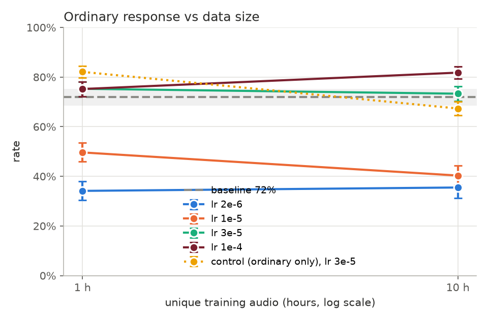
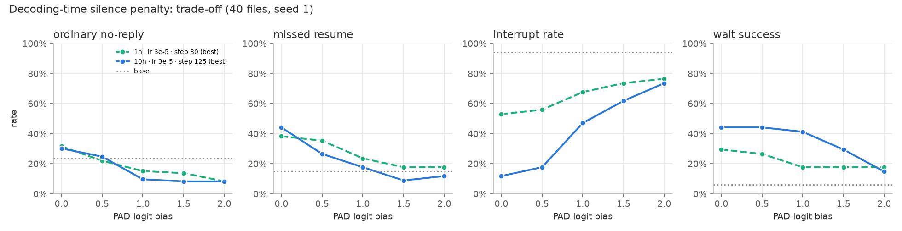
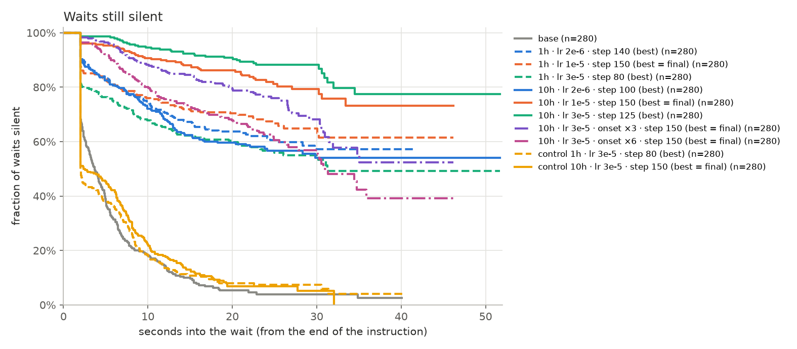

# Teaching Moshi conditional silence: how much synthetic data does it take?

Experimental report, 2026-11-15. Every number comes from a file in `results/` (named in each section);
rates are given as % (k/n) [95% CI]. Intervals come from a cluster bootstrap over conversation contexts,
since files that share a context are not independent; `*` marks a Wilson interval, used when every
context had the same outcome. Paired comparisons resample the same clusters for both models. Anything
marked **anecdotal** rests on 1–3 recordings or on live conversations and is not a measured result.

## Summary

- **Fine-tuning gives the model real conditional silence.** The base model succeeds on 3% of waits:
  it interrupts 94% of them. The 10 h model at lr 3e-5 succeeds on 49% (138/280) of held-out
  synthetic waits; with onset weighting, 54% (152/280) [49–60%]. The best model also answers more
  ordinary requests than the base: 90% vs 72%.
- **More unique data helps at equal compute.** With 44 h of training exposure at most, 10 h of unique
  data beats 1.1 h by +13.6 pp wait success [+7.1, +20.4] (paired, best checkpoints at lr 3e-5).
  Both sizes have only one learning rate that works well, 3e-5, the highest one tried.
- **Waiting comes from the wait data.** Ordinary-only controls at the same settings wait no better than
  the base (4–5%).
- **Learning has two phases.** Silence is learned within tens of updates. Speaking again on cue is
  learned later, and only at 3e-5; lower rates stay in the "too quiet" phase. Weighting the loss on
  the first second of each Moshi turn (×3) cut missed resumes from 35% to 14% without losing wait
  success.
- **What doesn't work yet:**
  - returning at a stated time, and handling "give me N more seconds" (wait success 0–3%);
  - questions addressed to another person by name;
  - replies to the answer to the opening greeting;
  - staying responsive later in a conversation.
- **Data-requirement estimate:** about 1 h (60 conversations) is enough to stop most interruptions.
  10 h (540 conversations, 2.7 h of waits) gets about half of all waits fully right, with no sign of
  saturation. The 100 h point the brief asks for wasn't run, so how far beyond 10 h this goes is
  still open.

## 1. Question and setup

**Model and training.**
- **Checkpoint:** `kyutai/moshiko-pytorch-bf16`, fine-tuned with Kyutai's `moshi-finetune` (LoRA rank
  128, scaling 2.0, the full LM adapted).
- **Settings:** batch 16, seed 0, 150 steps (15 warm-up steps, then cosine decay). Checkpoints every 10
  steps for 1 h data and every 25 for 10 h.
- **Learning rates:** 2e-6, 1e-5 and 3e-5. Every run starts from the same checkpoint.
- **Compute:** one H200 takes about 38 min per run (`logs/overnight.log`: onset runs 07:23–08:01 UTC).

**Checkpoint selection.**
1. Every checkpoint gets a teacher-forced loss evaluation on all 403 eval files (`eval_loss.py`).
2. The 3 checkpoints with the highest P(silent through the whole wait), plus the final one, get
   streaming inference and scoring.
3. **Best** = the highest wait success among those whose ordinary response is at most 10 pp below the
   base's 72%. If none qualifies, the highest ordinary response wins, and the pick is flagged
   (`results/best_checkpoints.md`).

**Data generation** (details and reasons: `results/LOG.md`, `results/data_summary_v2.md`).
- **Scripts:** an LLM wrote content blocks (contexts, side conversations, option sets, dialogues,
  distractor exchanges). A generator assembles them into scripts with planned timing.
- **Audio:** Fish Audio TTS renders the scripts as stereo files. The left channel is Moshi, one fixed
  cloned voice; the right channel has the user plus the friend, visitor or other person, all mixed.
- **Moshi's channel during a wait:** exactly silent until the cue or deadline, followed by a fitting
  reply. A brief acknowledgement within 2 s of the instruction is allowed.
- **Realism:** pauses and room noise are added. Training sets also get right-channel augmentation:
  ±6 dB per-speaker gain, fan/café/street/quiet-room noise, laptop or phone mic coloring in about a
  third of files, reverb in about a quarter.
- **Behaviors and mix:** think time ("give me N seconds"), side conversation ("stay quiet until I'm
  back") and describe options ("let me finish before you comment"), 20% each, plus 40% ordinary
  conversations.
- **Conditions inside them:** user self-talk during think time, early ends, "wait"-like phrases in
  ordinary talk, questions to another person by name (Moshi silent), and requests addressed to Moshi
  by name (Moshi answers).
- **Distractors:** questions to the friend, near-miss return cues, and pauses before the user has
  finished.
- **Greeting:** every conversation opens with Moshi greeting the user.
- **No mute rule:** silence is always produced by the model, with no external rule.

**Held-out evaluation material.**
- **Content:** 20% of voices, every third phrasing, 12 of 40 topics, a third of friend names and
  distractor phrases, and a 271-name list split 2:1. `check_split_leakage.py` checks for leaks.
- **Eval-only conditions:** wait types phone call, door and reading; extensions ("five more
  seconds"); implicit returns ("anyway, where were we?"); think-time deadlines of 15 and 30 s.
- **Content-unique sets:** within a set, no building block appears in more than one file.
- **Eval set:** 400 files (`eval_v2`; 280 waits, 955 ordinary requests, 557 distractors), plus
  3 human recordings and their TTS twins.

**Data accounting** (`results/data_summary_v2.md`, `results/runs.csv`). Seen hours are training
exposure, not data: one sample is one whole file, so 150 steps × 16 = 2,400 file passes.

| set | files = unique scripts | unique audio | silence | wait time | epochs / seen h at 150 steps | Fish cost |
|---|---|---|---|---|---|---|
| train_1h_v2 | 60 | 1.10 h | 0.32 h | 0.29 h | 40.0 / 44.1 h | $0.86 |
| train_10h_v2 | 540 | 9.87 h | 2.97 h | 2.72 h | 4.44 / 43.9 h | $7.45 |
| control_1h_v2 (ordinary only) | 80 | 1.13 h | 0.28 h | 0 | 30.0 / 33.9 h | (subset) |
| control_10h_v2 (ordinary only) | 706 | 10.00 h | 2.46 h | 0 | 3.4 / 34.0 h | $8.55 |
| eval_v2 | 400 | 6.10 h | 2.04 h | 1.99 h | – | $4.15 |

The 1 h set is a prefix of the 10 h set, and the two runs see the same total audio. So "1 h vs 10 h"
compares the number of unique conversations at equal compute; the 1 h model just sees each one 9×
more often.

**Metrics** (`scripts/score.py`; voice activity detection on Moshi's channel):

| metric | definition |
|---|---|
| **wait success** | no interruption (≤ 0.5 s of speech after the 2 s ack grace) and a resume in the window after the cue or deadline |
| **missed resume** | no speech within 10 s of the cue |
| **distractor response** | speech after a distractor that should be ignored |
| **ordinary response** | speech within 5 s of an ordinary request |
| **talk-over** | Moshi starts speaking while the user is speaking |

The report also uses reply relevance (a blind judge of Moshi's text against a reference reply,
`relevance.py`) and teacher-forced silence probabilities (`eval_loss.py`).

## 2. Baseline

The unmodified model talks through almost every wait. Overall (`results/comparison.md`):

| metric | base model |
|---|---|
| wait success | 3% (9/280) [1–5%] |
| interrupt rate | 94% (263/280) |
| median time to first interruption | 3.4 s |
| distractor response | 68% (379/557) |
| response to other-name questions | 85% (34/40) |
| talk-over | 21% of user turns |
| ordinary response | 72% (687/955) |
| missed resume | 16% (45/280) |

In `results/plots/survival.png` (§8), the base's median time to its first interruption is 3.4 s after
the instruction ends, so most waits break just after the 2 s grace.

## 3. Behavior vs. data size and learning rate

Best checkpoint of each run on the 400 eval files (`results/best_checkpoints.md`). † = no checkpoint
met the ordinary-response limit, so the fallback rule picked it.

| data | lr | best step | wait success | interrupt | missed resume | ordinary response |
|---|---|---|---|---|---|---|
| base | – | – | 3% (9/280) | 94% | 16% | 72% (687/955) |
| 1 h | 2e-6 | 140† | 6% (16/280) [3–9%] | 39% | 80% | 34% (326/955) |
| 1 h | 1e-5 | 150† | 22% (62/280) [18–27%] | 33% | 57% | 50% (474/955) |
| 1 h | **3e-5** | 80 | **36% (100/280) [30–41%]** | 44% | 30% | 75% (719/955) |
| 10 h | 2e-6 | 100† | 7% (19/280) [4–10%] | 42% | 79% | 35% (339/955) |
| 10 h | 1e-5 | 150† | 12% (35/280) [9–16%] | 19% | 76% | 40% (385/955) |
| 10 h | **3e-5** | 125 | **49% (138/280) [43–55%]** | 13% | 35% | 73% (700/955) |




- **Learning rate decides whether training works at all.**
  - At 2e-6 and 1e-5, every run learns to stay silent but not to come back: missed resumes 57–80%,
    and only 34–50% of ordinary requests answered.
  - 3e-5 is the only rate whose best checkpoint keeps ordinary response within 10 pp of the base, at
    both sizes. It is the top of the grid, so the optimum may be higher.
- **Data size helps at lr 3e-5** (paired over the 400 files, 10h·s125 minus 1h·s80;
  `results/diagnostics/paired_diffs.txt`):

  | metric | 10 h − 1 h |
  |---|---|
  | wait success | +13.6 pp [+7.1, +20.4] |
  | interrupt rate | −30.7 pp [−36.8, −24.6] |
  | distractor response | −9.3 pp [−13.8, −4.9] |
  | ordinary response | −2.0 pp [−5.4, +1.6] (no change) |
  | missed resume | +5.0 pp [−1.4, +11.4] (no change) |

- **At lower rates, more data doesn't help within 150 steps.** At 1e-5 the 10 h run is worse (12% vs
  22%): it is still in the quiet phase (§5).

## 4. Controls: the waiting comes from the wait data

The controls are ordinary-only runs with the same schedule, lr 3e-5 and similar exposure (34 h seen):

| model | wait success | interrupt rate |
|---|---|---|
| base | 3% | 94% |
| control 1h (best step 80) | 4% (12/280) [2–7%] | 92% (257/280) |
| control 10h (best step 150) | 5% (13/280) [2–7%] | 92% (258/280) |
| 1h·lr 3e-5 (wait data) | 36% | 44% |
| 10h·lr 3e-5 (wait data) | 49% | 13% |

The controls do change turn-taking: talk-over falls from 21% to 6%, and control 1h answers 82% of
ordinary requests. So fine-tuning on these synthetic conversations makes Moshi more polite, but it
only learns to wait when the data contains waits.

One caveat: on the 3 human files the controls also "wait" on 2–3 of 6 waits, the same as the trained
1 h models. So that tiny set cannot separate learned waiting from general quieting.

## 5. Two-phase dynamics: silence first, speaking again later


Sources: `results/diagnostics/quiet40.md` (40 files, seed 1) and `results/metrics/loss_eval.csv`
(403 files, teacher-forced).

- **Silence is learned within tens of updates.** P(silent through an entire wait) goes from 0.003
  (base) to 0.046 / 0.115 / 0.245 at steps 10 / 20 / 30 of 1h·3e-5, and to 0.41 by step 25 of
  10h·3e-5. By step 50, every run at every learning rate is quieter than the base. Ordinary no-reply
  rises from 23% to 41–75%, and missed resumes from 15% to 41–94%.
- **Speaking again is learned later, and only at 3e-5.**
  - 1h·3e-5: no-reply 41% (step 50) → 7% (step 100).
  - 10h·3e-5: missed resumes 76% (step 50) → 44% (step 125).
  - 2e-6 and 1e-5 stay in the quiet phase for all 150 steps; 2e-6 is the same path, slower.
- **Teacher-forced loss barely registers the problem.** P(speak) in the 2 s after the cue stays at
  0.37–0.41, close to the base's 0.404, while behavior swings widely. A slightly lower per-frame
  chance of starting to speak compounds in free generation: once Moshi's own stream is silent, it
  conditions on that silence.
- **The 1 h model overshoots.** On 1h·3e-5, steps 80 → 90 → 100 → 150:

  | step | wait success | interrupt | ordinary response |
  |---|---|---|---|
  | 80 | 36% (100/280) | 44% | 75% |
  | 90 | 32% (90/280) | 54% | 78% |
  | 100 | 16% (44/280) | 80% | 92% |
  | 150 | 25% (69/280) | 71% | 92% |

  Its validation loss rises from 0.750 (step 20) to 1.550 (step 150), and its ordinary text loss
  reaches 2.96, worse than the base's 1.86. After 20+ epochs of 60 conversations it memorizes and
  swings from "too quiet" to "too talkative". The 10 h run doesn't overfit: its validation loss
  stays at 0.69–0.72 from step 50 on.
- **Live versus measured (anecdotal).** In a live conversation, 1h·3e-5 step 100 felt responsive and
  reasonably good at waiting. Measured, it is the dip shown above.

## 6. Null-adapter check

The 2e-6 runs were suspiciously quiet, so the pipeline itself was tested (`results/diagnostics/quiet40.md`).

- **Null adapter and config-built base are bit-identical to the base:** 40/40 identical text-token
  streams, maximum audio difference 0. The null adapter is the step-50 checkpoint with every LoRA B
  set to 0, loaded through the same LoRA path and config; the second control is the base built from
  the checkpoint config without LoRA (`run_inference.py --config`).
- **Batched inference isn't the cause:** step 50 of 1h·2e-6 is quiet at batch 1 too (no-reply 52% vs
  29% for the base at batch 1).
- **The update size grows with the learning rate** as expected: ‖2BA‖ at step 50 of the 1 h runs is
  0.82 / 2.88 / 7.02 for 2e-6 / 1e-5 / 3e-5.

So every behavioral change comes from the trained weights; the quietness is the first phase of §5,
not a bug.

## 7. Onset weighting: a diagnosed fix

**Diagnosis.** The best 10 h model's main failure was not speaking up again: missed resumes 35%
(97/280), against the base's 16%. Its teacher-forced P(speak after the cue) was unchanged (0.406 vs
0.404). The frames where a turn begins are few and hard, and the loss averages them away.

**Fix.** Multiply the training loss on Moshi's text and audio tokens by w over the first 1.0 s of
every Moshi turn: greeting, reply, acknowledgement, resume. This is a training-loss change (code in
`finetune/loss.py` and `finetune/data/interleaver.py`; default off), not a decoding rule. Two runs used
w = 3 and w = 6, otherwise identical to 10h·3e-5. In a one-batch check, 58 of 1,250 frames were
weighted.

**Before and after** (400 files; differences paired with step 125, `results/diagnostics/paired_diffs.txt`):

| model | wait success | interrupt | missed resume | resume on time | distractor resp. | ordinary resp. | talk-over |
|---|---|---|---|---|---|---|---|
| base | 3% | 94% | 16% | 64% | 68% | 72% | 21% |
| 10h·3e-5 step 125 (before) | 49% (138/280) | 13% | 35% (97/280) | 55% | 15% | 73% (700/955) | 1% |
| **onset ×3, step 150** | **54% (152/280)** | 28% | **14% (40/280)** | 75% | 22% | **90% (858/955)** | 3% |
| ×3 − before (pp) | +5.0 [−0.4, +10.4] | +15.0 [+10.4, +19.6] | −20.4 [−25.4, −15.4] | +20.0 | +7.9 [+4.9, +10.9] | +16.5 [+13.9, +19.3] | +1.6 |
| onset ×6, step 150 | 46% (130/280) | 40% | 9% | 78% | 30% | 94% | 5% |

- **The replies are relevant** (`results/metrics/relevance.csv`: blind-judged, the same fixed sample of
  50 resumes and 50 ordinary replies, no reply counted as a failure):

  | model | fitting resumes | fitting ordinary replies |
  |---|---|---|
  | base | 22% (11/50) | 54% (27/50) |
  | step 125 | 40% (20/50) | 48% (24/50) |
  | onset ×3 | 62% (31/50) | 80% (40/50) |

- **×3 is the better weight.** ×6 talks more without waiting better. Neither run's wait success had
  stopped rising: ×3 went 46% → 53% → 54% at steps 100 / 125 / 150, so a longer run may help.
- **A decoding-time alternative helps less.** Lowering the silence token's logit by a fixed bias at
  every step is a global sampling setting, not a mute rule (`results/diagnostics/pad_bias.md`; 40
  files). On step 125, bias 0.5 cuts missed resumes from 44% to 26% at unchanged wait success (44%),
  but leaves ordinary no-reply near the base (25%). Bias ≥ 1 brings interruptions back (47–74%).



## 8. Generalization by eval group

Wait success per eval group (`results/comparison.md`, eval-group sections; group = what is new in
the file):

| eval group | waits | base | 1h·3e-5 s80 | 10h·3e-5 s125 | onset ×3 s150 |
|---|---|---|---|---|---|
| familiar type (new voices/phrasings/topics) | 160 | 2% (4) | 39% (63) | 48% (77) [41–56%] | 50% (80) [42–58%] |
| new type: phone call | 40 | 0% (0)* | 8% (3) | 50% (20) [35–65%] | 50% (20) [35–65%] |
| new type: door visitor | 40 | 0% (0)* | 35% (14) | 42% (17) [28–57%] | 60% (24) [45–75%] |
| new type: reading | 40 | 12% (5) | 50% (20) | 60% (24) [45–75%] | 70% (28) [55–82%] |
| implicit return (no explicit cue) | 70 | 3% (2) | 30% (21) | 54% (38) [43–66%] | 59% (41) [47–70%] |
| extension ("N more seconds") | 34 | 6% (2) | 0% (0)* | 0% (0)* | 3% (1) [0–9%] |
| other-name question in the file | 28 | 0% (0)* | 29% (8) | 36% (10) [18–54%] | 21% (6) [7–39%] |

**What generalizes.**
- The instruction carries over to new voices, phrasings and topics.
- It carries over to wait types never trained on: on phone calls, the 10 h model succeeds on 50% of
  waits, against 0% for the base.
- It carries over to returns without an explicit cue: 54% on implicit returns.
- Ordinary response holds in ordinary conversations: 76% (405/532) for step 125 and 91% for onset ×3,
  against 79% for the base.

**What doesn't.** Extensions fail completely (§10), and questions addressed to another person remain
hard.



## 9. Real vs. synthetic speech (anecdotal: 3 recordings)

Sources: `results/comparison.md` (group `human`) and `results/human_tts/comparison.md`.
- **The test set:** three recordings by one speaker:
  - `extend10sec` (an extension);
  - `talktoroommate` (side conversation, with a question to the roommate);
  - `regularconvo` (ordinary).
- **TTS twins:** the same words re-voiced by held-out Fish voices at the original onsets, sped up
  ≤ 1.35× where needed. Each model ran 3 seeds per file, so there are 6 wait runs and 9 ordinary
  requests.

**Results** (the intervals span most of 0–100%):
- **Waits:**
  - base: 0/6 successes, interrupts 5/6;
  - onset ×3: 3/6 successes, 0/6 interruptions;
  - step 125: 1/6 successes.
  - All four models compared on both versions score the same wait success on the real recordings as
    on their twins.
- **Ordinary requests:** the clearest real-vs-synthetic gap is here. Step 125 answers 2/9 real
  requests but 7/9 on the TTS twin; onset ×3 answers 8/9 on both. That is consistent with a real
  voice and microphone making the model slower to take its turn. Onset weighting removed the gap
  here, but one recording can't establish that.

**Limits.** No conclusion about real speech is statistically supported: one speaker, three
recordings, no real speech in training. The controls also "wait" on 2–3 of 6 human waits (§4).

## 10. What failed

1. **Timed returns and extensions.** The models learned "be quiet until something happens", not "come
   back after N seconds". Waits with a deadline (think time, eval deadlines 15/30 s, no early end;
   `results/diagnostics/report_extra.md` §3; resume error is first speech relative to the deadline):

   | model | within ±3 s (14 waits) | no resume in the file | with an extension: within ±3 s (34 waits) |
   |---|---|---|---|
   | step 125 | 0% (0/14) [0–22%]* | 50% (7/14) | 3% (1/34) |
   | onset ×3 | 21% (3/14) | 29% (4/14) | 6% (2/34) |

   With an extension, onset ×3 mostly speaks early: 62% of those 34 waits. Signed resume errors are
   in `comparison.md`. Training had only explicit deadlines (5–60 s) and no extensions; with 14 plain
   timed waits in eval, the estimates are coarse.
2. **Replying to the answer to the greeting.**
   - **Data flaw (measured):** in none of the 60/540 training files and 80/706 control files does
     Moshi reply to the user's answer to its greeting. The user always goes straight on, after a
     median gap of 0.42 s (`report_extra.md` §1).
   - **Effect (anecdotal):** on the human `regularconvo` file ("Hi, I'm okay. How are you?"), step 125
     replied in 0/3 seeds on the real recording, though 3/3 on its twin. Base and 1h replied 3/3, and
     onset ×3 2/3.
   - **Fix:** this is a v3 data change.
3. **Going silent later in a session.**
   - **Reported from live conversations** with `talk.sh` (anecdotal, not measured): the fine-tuned
     model talks less as a session goes on.
   - **Measured within the ≤ 85 s eval files** (`report_extra.md` §2):

     | model | requests < 20 s in | requests ≥ 40 s in |
     |---|---|---|
     | base | 70% (335/477) | 69% (174/253) |
     | step 125 | 82% (392/477) [79–85%] | 57% (144/253) [51–63%] |
     | onset ×3 | 95% | 83% |

     Step 125's answer rate falls sharply later in a conversation; the base's doesn't.
   - **Not testable here:** sessions of several minutes. Training files are under 100 s, so the model
     has never seen a later turn.
4. **Interruptions after questions to another person by name.**
   - Overall, step 125 still responds to 20% (8/40) of these and onset ×3 to 48% (19/40), against
     85% for the base.
   - Onset ×3 is worst inside wait conversations: 57% (16/28), against 21% for step 125.
   - Upweighting turn onsets made the model quicker to take any turn, including turns that weren't
     its own. This is the main cost of the fix.
5. **Side effect: voice.** The LoRA moves Moshi's voice toward the cloned training voice. ECAPA
   similarity to the training voice goes from 0.48 (base) to 0.68 (onset ×3). Similarity to the
   base's own output stays near its seed-to-seed floor: 0.63 vs 0.65.

## 11. How much data? An honest estimate

- **To stop most interruptions:** 1 h (60 conversations, 0.29 h of waits) at lr 3e-5 for about 50–80
  updates is enough. Interruptions fall from 94% to 44%, and wait success rises to 36%. It is
  fragile: it overfits by step 100.
- **To hold a wait and come back:** 10 h (540 conversations, 2.7 h of waits) gives 49–54% wait success
  on held-out synthetic users, with ordinary responsiveness at or above the base. Without onset
  weighting, the main remaining failure is not coming back (35% missed resumes); with it, it is
  interrupting (28%). This is the best measured point, and it is not saturated: +13.6 pp from 1 h to
  10 h at equal compute.
- **Beyond 10 h:** there are only two data sizes and one working learning rate, so no curve can be
  fitted. A naive log-linear extrapolation (+14 pp per 10×) would put 100 h near 65%. That is a
  guess, not a measurement.
- **Two failure classes data volume alone won't fix:** timed returns and extensions, and turn-taking
  after an answer the data never models. They need different data.
- **Real speech:** no estimate is possible for real users from 3 recordings.

## 12. Next experiments

1. **Real speech in training.** Mix in real recordings, a few hours of read or acted conversations,
   on the user channel. Also build a real-speech test set of about 50 recordings from several
   speakers. Without it, transfer to real users can't be measured (§9).
2. **v3 data fixes:**
   - Moshi replies to the greeting answer;
   - explicit timed returns with varied deadlines, plus extensions in training;
   - longer sessions with turns after 2–5 minutes, which needs longer crops;
   - more other-name questions during waits.
3. **Padding masking.** Down-weight or mask the loss on the long runs of silence padding after the
   wait has started, so the gradient isn't dominated by "keep being silent". It is the complement to
   onset weighting.
4. **100 h** at lr 3e-5, plus 3e-5 to 1e-4 at 10 h, since the optimum may lie above the grid. Track
   unique conversations and seen hours separately, as here.
5. **A longer onset ×3 run** (300 steps). Its wait success was still rising at step 150. Also test
   onset ×3 plus a PAD bias of 0.5.

**Not done from the brief:**
- the 100 h and 1,000 h scales;
- the optional "talk about trees more often" experiment.

## 13. Demo and audio examples

- **Live demo:** `scripts/talk.sh onset3` serves the best model in the browser (moshi.server, port
  8998). `scripts/talk.sh base` serves the base, and `scripts/talk.sh RUN [STEP]` any kept checkpoint.
- **Audio examples:** `scripts/pick_listen.py MODEL` copies a wait success, an interruption, a missed
  resume and an ordinary reply per model into `listen/`.
- **Human-file comparisons:** `listen_onset_w3/{real,tts_twin}/` holds base, step 125 and onset ×3 on
  the 3 human recordings and their twins.
- **Not in git:** the audio is kept out of the repository, since data/audio policy is to keep WAVs out.

## 14. Reproducing the results

All commands run from the repository root with `.venv/bin/python`. The TTS steps need a Fish Audio key
in the environment.

```bash
# Data (v2): scripts, audio, indexes and summary (results/data_summary_v2.md)
bash scripts/gen_datasets_v2.sh
bash scripts/render_all_v2.sh
python scripts/build_datasets_v2.py
python scripts/make_control_1h_v2.py
python scripts/check_split_leakage.py --train data/v2/scripts/train --eval data/v2/scripts/eval

# Configs (lr grid, controls at 3e-5), training (one run per GPU), evaluation of one run
python scripts/make_run_configs.py --control-lr 1h=3e-5 10h=3e-5
bash scripts/train_pair.sh train_1h_v2_lr3e-5 train_10h_v2_lr3e-5
python scripts/eval_run.py train_10h_v2_lr3e-5 0
#   eval_run.py: eval_loss on every checkpoint, inference + scoring of 4 candidates, best pick,
#   voice similarity, runs.csv, comparison.md, plots

# Baseline
python scripts/eval_loss.py
python scripts/run_inference.py data/indexes/eval_v2.jsonl --seeds 1 --batch 32 --gpu 0 --out-dir runs/base/infer/eval
python scripts/score.py --outputs runs/base/infer/eval --events data/indexes/eval_v2.jsonl --name base

# Onset weighting (configs/train_10h_v2_lr3e-5_onsetw{3,6}.yaml) and the PAD-bias sweep, as run overnight
bash scripts/overnight.sh
bash scripts/pad_bias_sweep.sh 0 train_10h_v2_lr3e-5__s125 0.5 1 1.5 2
python scripts/pad_bias_report.py

# Diagnostics: quiet phase, paired differences, extra measurements
#   (diag_quiet.sh needs the checkpoint weights; intermediate steps such as s050 were deleted after
#   evaluation, so rerunning them needs retraining. The null adapter was made by hand: a copy of the
#   step-50 checkpoint with every LoRA B tensor set to 0, run with run_inference.py --lora like any
#   checkpoint.)
bash scripts/diag_quiet.sh 0 base train_1h_v2_lr2e-6__s050
python scripts/diag_quiet_report.py
python scripts/paired_diff.py train_10h_v2_lr3e-5__s125 train_10h_v2_lr3e-5_onsetw3__s150
python scripts/report_extra.py

# Human recordings, TTS twins, reply relevance (blind judge per results/relevance/JUDGE.md)
python scripts/make_human_tts.py
python scripts/human_tts_compare.py base train_10h_v2_lr3e-5__s125 train_10h_v2_lr3e-5_onsetw3__s150
python scripts/relevance.py --tag onset prepare train_10h_v2_lr3e-5_onsetw3__s150
python scripts/relevance.py collect

# Tables and plots
python scripts/compare.py
python scripts/plot_results.py
python scripts/runs_table.py
```

Every decision and its reason is logged, newest first, in `results/LOG.md`.
