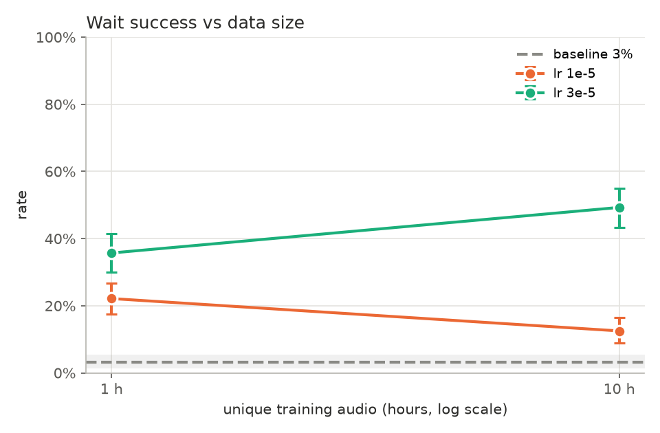
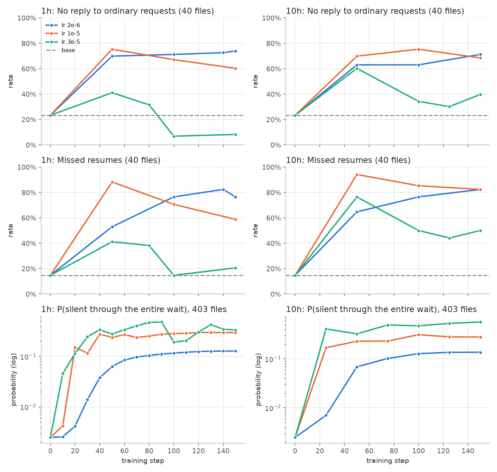

# Teaching Moshi conditional silence: how much synthetic data does it take?

Experimental report, 2026-11-15. Detailed tables, more plots and the commands to reproduce every
result are in [REPORT_APPENDIX.md](REPORT_APPENDIX.md).

## Executive summary

1. **What it achieved.** About 10 hours of synthetic conversations (540 unique scripts, 2.7 h of
   them waiting) and a LoRA fine-tune of 150 updates take Moshi from 3% to 49% wait success on
   held-out waits. With a loss weighted toward the start of each turn, it reaches 54%. Wait success
   means it stays silent through the wait and then resumes on cue. The fine-tuned model also answers
   more ordinary requests than the base: 90% vs 72%.
2. **Data-requirement estimate.** About 1 hour (60 conversations) is enough to stop most
   interruptions. About 10 hours gets roughly half of all waits fully right and is not saturated:
   +14 points over 1 hour at equal compute. We did not run 100 hours, so anything beyond 10 hours
   is extrapolation.
3. **Main generalization result.** The behavior transfers to unseen voices, wordings and topics,
   and to wait situations never seen in training:
   - phone calls 50%,
   - a visitor at the door 42–60%,
   - reading 60–70%,
   - returns without an explicit cue 54–59%,
   - compared with 0–12% for the base.
   Ordinary-only control runs show that the waiting comes from the wait data.
4. **Main failure: timed returns.** The model learned "stay quiet until something happens", not
   "come back after N seconds". It resumes within 3 s of a stated deadline in at most 3 of 14 timed
   waits, and when the user extends the wait it almost never succeeds (0–3%).
5. **Main failure: real speech is untested.** The only evidence on real speech is three recordings
   of one speaker, with no real speech in training. Whether these numbers hold for real users is
   the most important open question.

## How to read the numbers

- Rates are given as % (k/n) [95% CI]. Intervals come from a cluster bootstrap over conversation
  contexts, because files that share a context are not independent evidence.
- Differences between two models are *paired*: both are scored on the same 400 files.
- Anything marked **anecdotal** rests on 1–3 recordings or on live conversations.
- Every number comes from a file in `results/`; the appendix names the file for each table.

## 1. Setup

**Model and training.**
- Kyutai's public duplex checkpoint `kyutai/moshiko-pytorch-bf16`, fine-tuned with Kyutai's
  `moshi-finetune` code using LoRA (rank 128).
- Every run: 150 updates of 16 conversations, the same seed, the same starting checkpoint, about
  38 minutes on one GPU.
- Two data sizes (1.1 h and 9.9 h) and three learning rates (2e-6, 1e-5, 3e-5), plus ordinary-only
  control runs at both sizes.
- From each run, the reported "best" checkpoint has the highest wait success among checkpoints that
  still answer ordinary requests within 10 points of the base.

**Data.**
- An LLM wrote the conversation content and Fish Audio TTS voiced it. Each stereo file has Moshi in
  one fixed voice on the left. The right channel carries the user and, where present, the friend,
  visitor or other person, all mixed.
- While Moshi should wait, its channel is silent; after the cue it gives a fitting reply. One brief
  acknowledgement is allowed in the first 2 s. No external mute rule is used: the model must produce
  the silence itself.
- **Trained behaviors:** "give me N seconds to think" (any N from 5 to 60 s except 15 and 30),
  "I'm talking to my friend, stay quiet until I'm back", and "let me describe the options before
  you comment". Each is 20% of the data; the remaining 40% are ordinary conversations.
- **Conditions and distractors mixed in:** the user thinking aloud, ending a wait early, saying
  "wait" in ordinary talk, asking the friend questions, near-miss return cues, pausing mid-sentence,
  and addressing another person by name.
- **Augmentation:** training audio gets varied noise, microphones and levels on the user channel.

**Held out for evaluation.**
- 20% of voices, a third of the phrasings, names and distractor lines, and 12 of 40 topics.
- Wait situations never trained on: a phone call (only the user's side heard), a visitor at the door,
  reading.
- Extensions ("give me five more seconds"), returns without an explicit cue, and deadlines of 15 and
  30 s.

**Accounting.**
- The sets are content-unique: no conversation building block repeats within a set.
- Unique conversations, unique hours, silence hours and seen hours are tracked separately:
  - 1 h set: 60 conversations, 0.32 h of silence.
  - 10 h set: 540 conversations, 2.97 h of silence.
- Both sizes get the same compute, about 44 seen hours at 150 updates. That is 40 passes over the 1 h
  set and 4.4 over the 10 h set, so 1 h vs 10 h compares *unique* data, not exposure.
- The eval set has 400 files: 280 waits, 955 ordinary requests and 557 distractors. On top of that come
  3 human recordings and their TTS twins.

**Metrics** (voice activity on Moshi's channel):

| metric | definition |
|---|---|
| wait success | no speech beyond the 2 s acknowledgement window until the cue, then a resume in time |
| interrupt rate | speaking during the wait |
| missed resume | no speech within 10 s of the cue |
| ordinary response | speech within 5 s of an ordinary request |
| distractor response | speaking after a distractor that should be ignored |

## 2. Results at a glance

400 held-out eval files, seed 1. † = no checkpoint of the run kept ordinary response within 10 points
of the base, so its highest-ordinary-response checkpoint is shown.

| model | wait success | interrupt | missed resume | ordinary response | distractor response |
|---|---|---|---|---|---|
| base (unmodified) | 3% (9/280) [1–5%] | 94% | 16% | 72% (687/955) | 68% |
| 1 h · lr 2e-6 † | 6% (16/280) [3–9%] | 39% | 80% | 34% | 15% |
| 1 h · lr 1e-5 † | 22% (62/280) [18–27%] | 33% | 57% | 50% | 17% |
| 1 h · lr 3e-5 (step 80) | 36% (100/280) [30–41%] | 44% | 30% | 75% | 24% |
| 10 h · lr 2e-6 † | 7% (19/280) [4–10%] | 42% | 79% | 35% | 16% |
| 10 h · lr 1e-5 † | 12% (35/280) [9–16%] | 19% | 76% | 40% | 11% |
| 10 h · lr 3e-5 (step 125) | 49% (138/280) [43–55%] | 13% | 35% | 73% (700/955) | 15% |
| control 1 h (ordinary only) | 4% (12/280) [2–7%] | 92% | 26% | 82% | 46% |
| control 10 h (ordinary only) | 5% (13/280) [2–7%] | 92% | 31% | 67% | 49% |
| **10 h · lr 3e-5 · onset ×3 (step 150)** | **54% (152/280) [49–60%]** | 28% | **14%** | **90% (858/955)** | 22% |

## 3. Data size and learning rate

**The learning rate decides whether fine-tuning works at all.**
- At 2e-6 and 1e-5, every run learns to be quiet but not to come back. Missed resumes are 57–80%,
  and only 34–50% of ordinary requests get an answer.
- Only 3e-5 keeps ordinary responses at the base's level while teaching waiting, at both data sizes.
- 3e-5 is the highest rate we tried, so the best rate may be higher still.

**At 3e-5, more unique data helps at the same compute.** Comparing 10 h (step 125) with 1 h (step 80)
on the same files:
- wait success +13.6 points [+7.1, +20.4];
- interruptions −30.7 points;
- distractor responses −9.3 points;
- ordinary response unchanged.

**At the lower rates, 10 h is not better within 150 updates.** It hasn't left the quiet phase (§5).

## 4. The waiting comes from the wait data

The control runs use the same settings and similar compute (34 seen hours) on ordinary
conversations only. They wait no better than the base: 4–5% wait success, 92% interruptions.

Fine-tuning on these synthetic conversations does change turn-taking: Moshi talks over the user less
(6% vs 21%). But it learns to wait only when the data contains waits.

## 5. How learning unfolds: silence first, speaking again later

**Silence is learned within tens of updates.**
- The predicted probability of staying silent through an entire wait rises from 0.003 (base) to
  0.25 by update 30 on the 1 h data.
- By update 50, every run at every learning rate is quieter than the base. Missed resumes rise from
  15% to 41–94% on a 40-file diagnostic set.

**Speaking again on cue comes later, and only at 3e-5.**
- 1 h data: unanswered ordinary requests fall from 41% at update 50 to 7% at update 100.
- 10 h data: missed resumes fall from 76% at update 50 to 44% at update 125.
- The lower learning rates never leave the quiet phase within 150 updates.

**The teacher-forced loss barely shows this.** The predicted chance of speaking just after the cue
stays near the base's 0.40. In free generation, though, a slightly lower per-frame chance of starting
to talk compounds, because once Moshi's own stream is silent it conditions on that silence.

**With only 1 h of data, the model overshoots.**
- Wait success falls from 36% at update 80 to 16% at update 100, as interruptions jump from 44% to
  80%.
- By then it has seen each of its 60 conversations more than 20 times, and its validation loss has
  been rising since update 20.
- The 10 h run doesn't overfit.
- **Anecdotal:** the 1 h checkpoint at update 100 felt responsive and good at waiting in a live
  conversation, but the 400-file evaluation shows it is the worst point of the run.

**Null-adapter check.** The low-learning-rate runs were suspiciously quiet, so we tested the
pipeline itself:
- A "null adapter" (a trained checkpoint with its learned update zeroed) produces output
  bit-identical to the base: 40/40 identical outputs.
- So does the base model loaded from a checkpoint's configuration.
- The quietness also persists without batching.

Every behavioral change therefore comes from the trained weights: the quiet phase is real, not a
bug.

## 6. Onset weighting: a diagnosed fix for missed responses

**Diagnosis.** The best 10 h model's main weakness was not speaking up again: it missed 35% of
resumes, against the base's 16%. The frames where Moshi starts a turn are few among many silent
frames, so the loss averages them away.

**Fix.** Multiply the training loss on Moshi's tokens by 3 over the first second of every Moshi turn,
everything else unchanged. This changes training only; the model is still free to speak or not.

**Effect, against the same 10 h model** (paired, same 400 files):

| metric | change with onset ×3 |
|---|---|
| missed resumes | 35% → 14% (−20 points [−25, −15]) |
| ordinary response | 73% → 90% (+17 points) |
| wait success | 49% → 54% (+5 points [−0.4, +10.4]: at least no loss) |
| interruptions | 13% → 28% (cost) |
| distractor responses | 15% → 22% (cost) |

**The extra replies are on topic.** A blind judge, counting no reply as a failure, rated 80% (40/50)
of ordinary replies as fitting, against 48% before; for resumes, 62% against 40%.

**Weighting by 6 overshoots.** It talks more without waiting better.

**A decoding-time alternative is weaker.** Lowering the silence token's score by a fixed amount at
every step is a global setting, not a mute rule. A small penalty halves missed resumes, but leaves
unanswered requests near the base's level. Any larger penalty brings interruptions back.

## 7. Generalization

The fine-tuned models carry the instruction over to every kind of held-out material:
- **New voices, wordings and topics** for trained wait types: 48–50% wait success.
- **New wait situations:**
  - phone calls 50% (base 0%);
  - visitors at the door 42–60% (base 0%);
  - reading 60–70% (base 12%).
- **Returns without an explicit cue** ("anyway, where were we?"): 54–59% (base 3%).
- **Ordinary conversations:** 76–91% of requests answered (base 79%).

Interruptions stay low for the 10 h model on every new wait type: 2–20%.

The survival curves show how long each model stays silent once a wait begins. The base breaks most
waits within seconds; the 10 h model still has about 78% of waits uninterrupted at the end.

**What does not generalize:**
- **Extensions:** at most 1 of 34 waits succeeds.
- **Questions to another person by name** inside a wait: 21–57% are still answered (base 79%).

Both are covered in §9.

**In-distribution vs held-out vs human speech.** As an in-distribution check, we tested 60 rendered
training-list files that no run trained on: 24 ordinary conversations and 12 of each trained wait
type. They use the training split's voices, phrasings, topics and audio augmentation, but are new
conversations, none of them in any training index. Each cell gives the overall score (0–100, the mean
of silence, return, answer and addressee; `results/checkpoint_table.md`), then wait success.

| condition | base | 10 h · lr 3e-5 · step 125 | onset ×3 · step 150 |
|---|---|---|---|
| in-distribution (60 files, 36 waits) | 47.0 [42.0–52.2]; 3% (1/36) | 73.3 [67.5–79.2]; 33% (12/36) | 86.5 [81.7–91.1]; 56% (20/36) |
| held-out, trained types; only voices/wording/topics new (202 files, 94 waits) | 48.4 [45.6–51.5]; 2% (2/94) | 82.8 [79.3–86.0]; 69% (65/94) | 86.0 [82.2–89.5]; 71% (67/94) |
| held-out, new wait types (120 files) | 48.0 [45.2–50.9]; 4% (5/120) | 76.7 [73.1–80.1]; 51% (61/120) | 81.8 [77.7–85.7]; 60% (72/120) |
| human speech (3 recordings × 3 seeds; anecdotal) | 41.7; 0/6 | 59.7; 1/6 | 84.7; 3/6 |

Sources: `results/in_distribution/comparison.md` (`scripts/make_in_distribution.py`,
`scripts/in_dist_compare.py`).

The in-distribution files are not easier; for step 125 they are clearly harder. Two causes show up in
the per-file results:
- **The mix.** A third of the in-distribution waits are think time, 10 of 12 with a deadline. Timed
  think time fails everywhere: 0/10 here and 0/12 held-out.
- **Side conversations.** Step 125 succeeds on 4 of 12, against 27 of 32 held-out, and the failures
  are almost all missed resumes.

A plausible reason for the side conversations: 360 of the 400 eval files come from the v1 generator,
whose return cues are plain ("I'm back"). The training data also uses v2 cues: fragments and implied
returns such as "Done and dusted. Go ahead." Step 125 missed 5 of 6 in-distribution side
conversations with v2-style cues, but also 3 of 6 with v1-style ones. With 12 files this is a
hypothesis.

The training audio augmentation showed no consistent effect at this sample size.

The held-out eval may therefore overstate performance on the full range of phrasing styles in
training. Onset ×3 closes the gap: 86.5 in-distribution, 86.0 held-out.

## 8. Real versus synthetic speech (anecdotal)

**The human test set** is three recordings by one speaker:
- extending a wait;
- a side conversation with a roommate;
- an ordinary chat.

Each recording also has a **TTS twin**: the same words in held-out synthetic voices at the same
times. Each model ran 3 seeds per file, so every comparison rests on 6 waits and 9 requests.

**What we see:**
- **The best model:**
  - waits successfully on 3 of 6 real waits;
  - never interrupts;
  - answers 8 of 9 real requests.
- **The base:**
  - succeeds on none;
  - interrupts 5 of 6.
- **The 10 h model without onset weighting** shows the clearest real-versus-synthetic gap: it answers
  2 of 9 real requests but 7 of 9 on the twin. That suggests a real voice and microphone make it
  slower to take its turn.
- **Wait success** is the same on real audio and twins for every model compared.

**Why none of this is conclusive:**
- The intervals span most of 0–100%.
- The controls also "wait" on 2–3 of the 6 human waits, so this set can't separate learned waiting
  from general quieting.
- The training data contains no real speech.

## 9. What failed

**1. Timed returns and extensions.**
- The models don't track time. In 14 waits with a stated deadline, the 10 h model never resumed
  within 3 s of it: 0/14, [0–22%].
- In half of those waits, it never resumed at all.
- With onset weighting it resumes on time in 3/14, but speaks early in 62% of extended waits.
- **Why:** training has deadlines but no extensions, and the files give no other timing signal than
  the deadline itself.

**2. Replying to the answer to the greeting.**
- In none of the 540 training conversations does Moshi reply to the user's answer to its opening
  greeting: the user always continues within about half a second.
- **Anecdotal:** on the real recording, the 10 h model didn't reply to "I'm okay. How are you?" in
  any of 3 seeds. On the synthetic twin it replied in all 3.
- This is a data-design flaw.

**3. Going quiet later in a conversation.**
- **Live sessions (anecdotal, not measured):** the fine-tuned model talks less as a session goes on.
- **Within the 85-second eval files, measured:**

  | requests answered | in the first 20 s | from 40 s on |
  |---|---|---|
  | 10 h model | 82% | 57% |
  | base | 70% | 69% |
  | with onset weighting | 95% | 83% |

- Training files are under 100 s, so longer sessions were never seen.

**4. Questions addressed to another person by name.**
- The 10 h model still responds to 20% of them, against 85% for the base.
- The onset-weighted model responds to 48%, and to 57% inside wait conversations: being quicker to
  take a turn includes turns that aren't Moshi's. This is the main cost of the fix.

**5. Voice drift (a side effect).** Moshi's voice moves toward the cloned training voice.

## 10. How much data? An honest estimate

**To stop most interruptions:** about 1 hour (60 conversations, 0.3 h of waiting) at the right
learning rate and 50–80 updates.
- Interruptions fall from 94% to 44%, and wait success reaches 36%.
- It overfits soon after.

**To hold a wait and come back:** about 10 hours (540 conversations, 2.7 h of waiting).
- 49–54% wait success on held-out synthetic users, with ordinary responsiveness at or above the base.
- The curve is still rising: +14 points from 1 to 10 hours at equal compute.

**Beyond 10 hours:**
- With two data sizes and one working learning rate, no curve can be fitted.
- A naive +14 points per tenfold increase would put 100 hours near 65%. That is a guess, not a
  measurement.

**Not a matter of quantity:** timed returns and the greeting-answer turn need different data, not
more of the same.

**Real users:** no estimate is possible from three recordings.

## 11. Next experiments

1. **Real speech.** Add a few hours of real recorded conversation on the user channel, and build a
   real test set of about 50 recordings from several speakers.
2. **v3 data fixes:**
   - Moshi answers the greeting reply;
   - timed returns with varied deadlines, plus extensions in training;
   - longer sessions, with turns after 2–5 minutes;
   - more name-addressed questions during waits.
3. **Masking the padding loss.** Down-weight the long stretches of "keep being silent" after a wait
   has begun. This complements onset weighting.
4. **100 hours** at lr 3e-5, and learning rates above 3e-5 at 10 hours.
5. **A longer onset-weighted run** (300 updates; its wait success was still rising), and onset
   weighting combined with a small decoding penalty.

**Not done from the brief:** the 100 h and 1,000 h scales, and the optional "talk about trees more
often" experiment.

## 12. Demo and audio examples

- **Live demo:** `scripts/talk.sh onset3` serves the best model in the browser; `scripts/talk.sh base`
  serves the base model.
- **Example audio:** `scripts/pick_listen.py MODEL` collects examples of a wait success, an
  interruption, a missed resume and an ordinary reply.
- **Human recordings:** `listen_onset_w3/` holds the base, the 10 h model and the onset-weighted model
  on the three human recordings and their twins.
- Audio is kept out of git.
