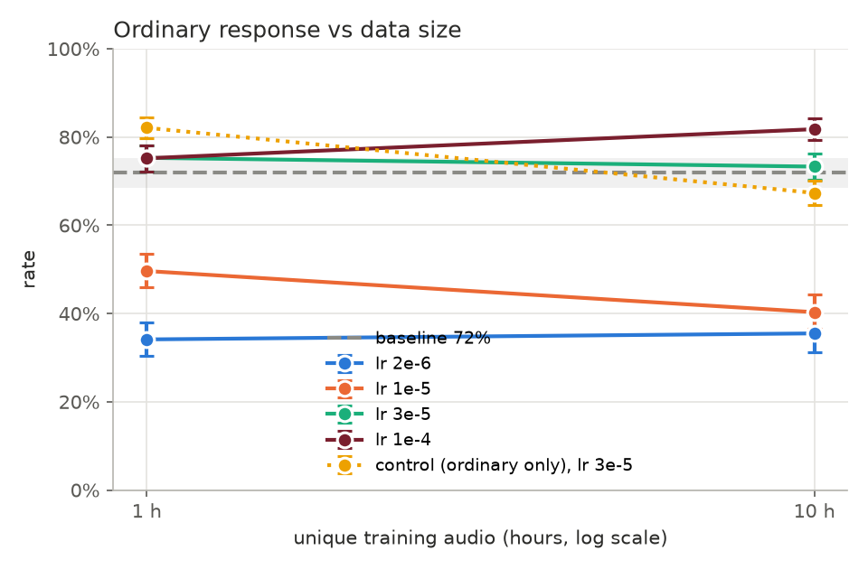
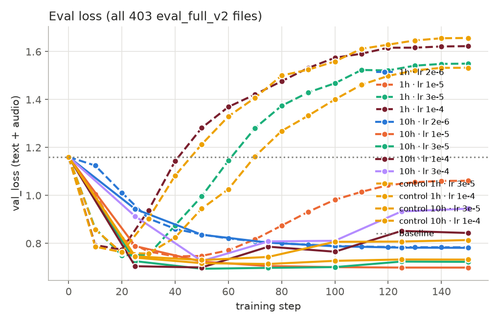
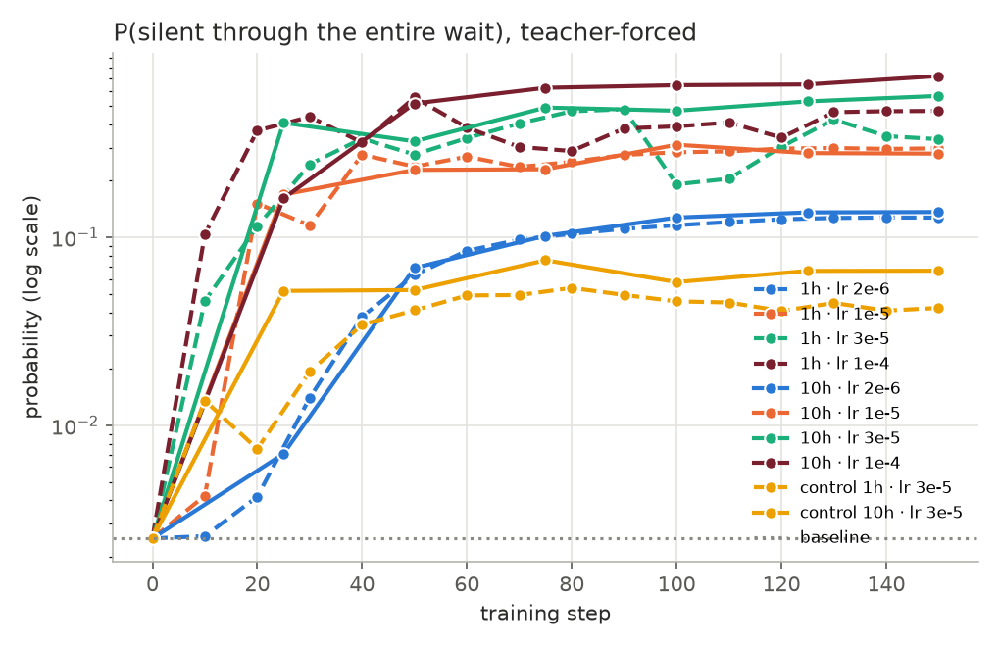
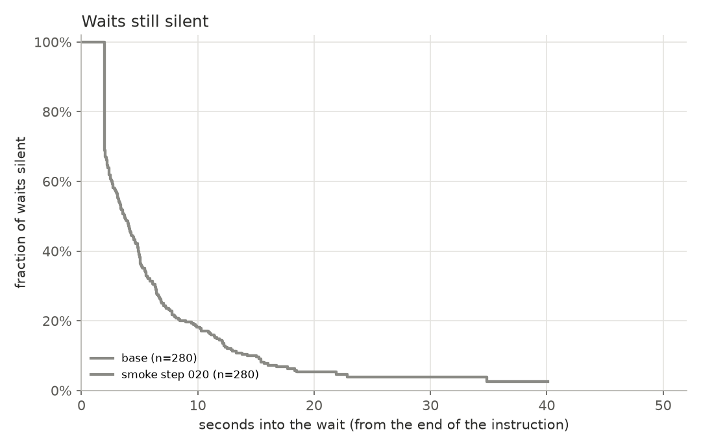
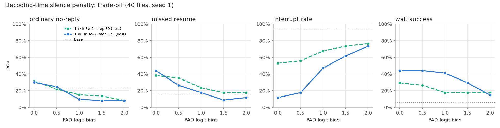

# Appendix to REPORT.md: detailed tables and reproduction

Rates are % (k/n) [95% CI]. Intervals come from a cluster bootstrap over conversation contexts; `*`
marks a Wilson interval, used when every context had the same outcome. The model is **10h·3e-5** =
10 h data, lr 3e-5. Every number comes from the file named with it in `results/`.

## A1. Setup details

**Training** (`configs/*.yaml`, `scripts/make_run_configs.py`):
- Base checkpoint `kyutai/moshiko-pytorch-bf16`; LoRA rank 128, scaling 2.0.
- Batch 16, seed 0, 150 steps (15 warm-up steps, then cosine decay). Every file is shorter than
  `duration_sec` (100 s), so one sample is one whole file.
- Checkpoints every 10 steps (1 h data) or 25 steps (10 h). One H200 takes about 38 min per run.

**Checkpoint selection** (`scripts/eval_run.py`, `results/best_checkpoints.md`):
1. Every checkpoint gets a teacher-forced loss evaluation on all 403 eval files (`eval_loss.py`).
2. The 3 checkpoints with the highest P(silent through the whole wait), plus the final one, get
   streaming inference: 400 eval files at seed 1, batch 32; human files at seeds 1 2 3.
3. **Best** = the highest wait success among those whose ordinary response is at most 10 pp below the
   base's 72%. Otherwise the highest ordinary response wins, flagged †.

**Data accounting** (`results/data_summary_v2.md`, `results/runs.csv`). Seen hours are training
exposure: 150 steps × 16 = 2,400 file passes.

| set | files = unique scripts | unique audio | silence | wait time | epochs / seen h at 150 steps | Fish cost |
|---|---|---|---|---|---|---|
| train_1h_v2 | 60 | 1.10 h | 0.32 h | 0.29 h | 40.0 / 44.1 h | $0.86 |
| train_10h_v2 | 540 | 9.87 h | 2.97 h | 2.72 h | 4.44 / 43.9 h | $7.45 |
| control_1h_v2 (ordinary only) | 80 | 1.13 h | 0.28 h | 0 | 30.0 / 33.9 h | (subset) |
| control_10h_v2 (ordinary only) | 706 | 10.00 h | 2.46 h | 0 | 3.4 / 34.0 h | $8.55 |
| eval_v2 | 400 | 6.10 h | 2.04 h | 1.99 h | – | $4.15 |

**Metrics** (`scripts/score.py`; voice activity detection on Moshi's channel):

| metric | definition |
|---|---|
| wait success | no interruption (≤ 0.5 s of speech after the 2 s ack grace) and a resume in the window after the cue or deadline |
| interrupt rate | more than 0.5 s of Moshi speech between instruction end + 2 s and the cue |
| missed resume | no speech within 10 s of the cue or deadline |
| distractor response | speech after a distractor that should be ignored |
| ordinary response | speech within 5 s of an ordinary request |
| talk-over | Moshi starts speaking while the user is speaking |
| reply relevance | blind judgement of Moshi's text against a reference reply (`relevance.py`, `results/relevance/JUDGE.md`) |

Also reported, teacher-forced (`eval_loss.py`): P(silent through the whole wait) and P(speak in the
2 s after the cue).

**Baseline** (`results/comparison.md`):

| metric | base |
|---|---|
| wait success | 3% (9/280) [1–5%] |
| interrupt rate | 94% (263/280); median first interruption 3.4 s after the instruction |
| distractor response | 68% (379/557) |
| other-name questions answered | 85% (34/40) |
| talk-over | 21% of user turns |
| ordinary response | 72% (687/955) |
| missed resume | 16% (45/280) |

## A2. Learning-rate grid: best checkpoints

Source: `results/best_checkpoints.md`.

| data | lr | best step | wait success | interrupt | missed resume | ordinary response |
|---|---|---|---|---|---|---|
| 1 h | 2e-6 | 140† | 6% (16/280) [3–9%] | 39% | 80% | 34% (326/955) |
| 1 h | 1e-5 | 150† | 22% (62/280) [18–27%] | 33% | 57% | 50% (474/955) |
| 1 h | 3e-5 | 80 | 36% (100/280) [30–41%] | 44% | 30% | 75% (719/955) |
| 10 h | 2e-6 | 100† | 7% (19/280) [4–10%] | 42% | 79% | 35% (339/955) |
| 10 h | 1e-5 | 150† | 12% (35/280) [9–16%] | 19% | 76% | 40% (385/955) |
| 10 h | 3e-5 | 125 | 49% (138/280) [43–55%] | 13% | 35% | 73% (700/955) |

**Paired 10h·3e-5 step 125 − 1h·3e-5 step 80** (400 files; `results/diagnostics/paired_diffs.txt`):

| metric | difference |
|---|---|
| wait success | +13.6 pp [+7.1, +20.4] |
| interrupt rate | −30.7 pp [−36.8, −24.6] |
| distractor response | −9.3 pp [−13.8, −4.9] |
| ordinary response | −2.0 pp [−5.4, +1.6] |
| missed resume | +5.0 pp [−1.4, +11.4] |





## A3. Controls (ordinary-only data, lr 3e-5)

Source: `results/comparison.md`.

| model | wait success | interrupt | ordinary response | distractor response |
|---|---|---|---|---|
| control 1h step 80 (best) | 4% (12/280) [2–7%] | 92% (257/280) | 82% (784/955) | 46% (254/557) |
| control 10h step 150 (best = final) | 5% (13/280) [2–7%] | 92% (258/280) | 67% (643/955) | 49% (273/557) |

Talk-over for the controls is 6%, against 21% for the base. On the 3 human files the controls also
"wait" on 2–3 of 6 waits.

## A4. Two-phase dynamics and the 1 h overshoot

Sources: `results/diagnostics/quiet40.md` (40 files, seed 1) and `results/metrics/loss_eval.csv` (403 files).

**P(silent through the whole wait):**
- base: 0.003;
- 1h·3e-5: 0.046 / 0.115 / 0.245 at steps 10 / 20 / 30;
- 10h·3e-5: 0.41 at step 25.

**After 50 steps (40-file set):**
- every run: ordinary no-reply 41–75% (base 23%), missed resumes 41–94% (base 15%);
- 1h·3e-5: no-reply back to 7% at step 100;
- 10h·3e-5: missed resumes 76% (step 50) → 44% (step 125);
- 2e-6 and 1e-5 stay in the quiet phase.

**P(speak in the 2 s after the cue)** stays at 0.37–0.41 throughout (base 0.404).

**1h·3e-5 by step** (400 files):

| step | wait success | interrupt | missed resume | ordinary response | val loss |
|---|---|---|---|---|---|
| 80 | 36% (100/280) | 44% | 30% | 75% | 1.374 |
| 90 | 32% (90/280) | 54% | 24% | 78% | 1.430 |
| 100 | 16% (44/280) | 80% | 11% | 92% | 1.468 |
| 150 | 25% (69/280) | 71% | 12% | 92% | 1.550 |

- Validation loss is lowest at step 20 (0.750). The ordinary text loss reaches 2.96 by step 150, worse
  than the base's 1.86.
- 10h·3e-5 validation loss stays at 0.69–0.72 from step 50 on.
- **Anecdotal:** step 100 felt responsive and good at waiting in a live test.

**Null-adapter check** (`results/diagnostics/quiet40.md`):
- **Two controls, both bit-identical to the base** (40/40 identical token streams, maximum audio
  difference 0): a null adapter (step-50 checkpoint with every LoRA B = 0, same config and loading
  path), and the base built from the checkpoint config without LoRA.
- **Batching isn't the cause:** 1h·2e-6 step 50 at batch 1 still has 52% no-reply, against 29% for
  the base at batch 1.
- **‖2BA‖ at step 50, 1 h runs:** 0.82 / 2.88 / 7.02 for 2e-6 / 1e-5 / 3e-5.



## A5. Onset weighting and the decoding-time silence penalty

Sources: `results/comparison.md`, `results/comparison_notes.md` and `results/diagnostics/paired_diffs.txt`.

| model | wait success | interrupt | missed resume | resume on time | distractor resp. | ordinary resp. | talk-over |
|---|---|---|---|---|---|---|---|
| base | 3% | 94% | 16% | 64% | 68% | 72% | 21% |
| 10h·3e-5 step 125 | 49% (138/280) | 13% | 35% (97/280) | 55% | 15% | 73% (700/955) | 1% |
| onset ×3 step 150 | 54% (152/280) [49–60%] | 28% (78/280) | 14% (40/280) | 75% | 22% (125/557) | 90% (858/955) | 3% |
| ×3 − step 125 (pp) | +5.0 [−0.4, +10.4] | +15.0 [+10.4, +19.6] | −20.4 [−25.4, −15.4] | +20.0 [+15.0, +24.6] | +7.9 [+4.9, +10.9] | +16.5 [+13.9, +19.3] | +1.6 [+0.7, +2.5] |
| onset ×6 step 150 | 46% (130/280) | 40% (113/280) | 9% (24/280) | 78% | 30% (167/557) | 94% (901/955) | 5% |

- Onset ×3 wait success by step: 46% (step 100), 53% (125), 54% (150).
- Teacher-forced P(speak after the cue): 0.440 at step 150, against 0.406 for step 125.

**Reply relevance** (`results/metrics/relevance.csv`: the same fixed 50 + 50 items; strict = no reply
counts as a failure):

| model | resumes, strict | ordinary, strict | resumes, of replies given | ordinary, of replies given |
|---|---|---|---|---|
| base | 22% (11/50) | 54% (27/50) | 26% (11/43) | 61% (27/44) |
| 10h·3e-5 step 125 | 40% (20/50) | 48% (24/50) | 74% (20/27) | 73% (24/33) |
| onset ×3 | 62% (31/50) [48–74%] | 80% (40/50) [68–90%] | 79% (31/39) | 85% (40/47) |
| onset ×6 | 58% (29/50) | 82% (41/50) | 74% (29/39) | 85% (41/48) |

**Decoding-time silence penalty** (`results/diagnostics/pad_bias.md`): the silence token's logit is
lowered by a fixed bias at every step. This is a global setting, not a mute rule. Results on 10h·3e-5
step 125, 40 files:

| bias | ordinary no-reply | missed resume | interrupt | wait success |
|---|---|---|---|---|
| 0 | 30% | 44% | 12% | 44% |
| 0.5 | 25% | 26% | 18% | 44% |
| 1 | 10% | 18% | 47% | 41% |
| 1.5 | 8% | 9% | 62% | 29% |
| 2 | 8% | 12% | 74% | 15% |



## A6. Results by eval group

Source: `results/comparison.md`, eval-group sections. Each cell is wait success, with the number of
successful waits in parentheses.

| eval group | waits | base | 1h·3e-5 s80 | 10h·3e-5 s125 | onset ×3 s150 |
|---|---|---|---|---|---|
| familiar type (new voices/phrasings/topics) | 160 | 2% (4) | 39% (63) | 48% (77) [41–56%] | 50% (80) [42–58%] |
| new type: phone call | 40 | 0% (0)* | 8% (3) | 50% (20) [35–65%] | 50% (20) [35–65%] |
| new type: door visitor | 40 | 0% (0)* | 35% (14) | 42% (17) [28–57%] | 60% (24) [45–75%] |
| new type: reading | 40 | 12% (5) | 50% (20) | 60% (24) [45–75%] | 70% (28) [55–82%] |
| implicit return (no explicit cue) | 70 | 3% (2) | 30% (21) | 54% (38) [43–66%] | 59% (41) [47–70%] |
| extension ("N more seconds") | 34 | 6% (2) | 0% (0)* | 0% (0)* | 3% (1) [0–9%] |
| other-name question in the file | 28 | 0% (0)* | 29% (8) | 36% (10) [18–54%] | 21% (6) [7–39%] |

**Interrupt rate**, 10h·3e-5 step 125 / onset ×3:

| eval group | step 125 | onset ×3 |
|---|---|---|
| familiar type | 13% | 27% |
| phone call | 20% | 45% |
| door visitor | 15% | 28% |
| reading | 2% | 15% |
| implicit return | 6% | 17% |
| extension | 29% | 68% |

**Ordinary response in ordinary conversations:** base 79% (420/532), step 125 76% (405/532), onset ×3
91% (485/532).

## A6b. In-distribution test set and the overall score

- **In-distribution files:** 60 rendered training-list files (`trainv2_10_00540`–`00719`) that no run
  trained on; `scripts/make_in_distribution.py`, index `data/indexes/in_distribution_v2.jsonl`.
  - Per-metric tables for base, 10h·3e-5 step 125 and onset ×3: `results/comparison.md`, section
    "In-distribution".
  - Comparison by condition: `results/in_distribution/comparison.md`.
  - None shares a building block with train_1h_v2 / train_10h_v2. Nine share a dialogue block with
    control_10h_v2, which the tested models never trained on; each such events file says so under
    `shares_block_with`.
- **Overall score:** for every checkpoint with behavioral results, the score (mean of four 0–100
  components: silence, return, answer, addressee) is in `results/checkpoint_table.md`. Per-run plots
  are `results/plots/overall_score_<run>.png`.

## A7. Human recordings and TTS twins (anecdotal: 3 files × 3 seeds)

Sources: `results/comparison.md` (group `human`) and `results/human_tts/comparison.md`.
- **Recordings:** `extend10sec`, `talktoroommate` and `regularconvo`, all by one speaker.
- **Twins:** the same words in held-out Fish voices at the original onsets, sped up at most 1.35×.

| model | audio | wait success | interrupt | ordinary response |
|---|---|---|---|---|
| base | real | 0/6 | 5/6 | 6/9 |
| base | twin | 0/6 | 6/6 | 9/9 |
| 10h·3e-5 step 125 | real | 1/6 | 0/6 | 2/9 |
| 10h·3e-5 step 125 | twin | 1/6 | 0/6 | 7/9 |
| onset ×3 | real | 3/6 | 0/6 | 8/9 |
| onset ×3 | twin | 3/6 | 0/6 | 8/9 |

## A8. Failure measurements

Source: `results/diagnostics/report_extra.md`.

**Timed returns.** First speech relative to the deadline: on time = within ±3 s; early = more than 3 s
before; none = no speech in the file after the grace.

| model | waits | on time | early | late | none |
|---|---|---|---|---|---|
| base | deadline (14) | 14% (2) | 57% (8) | 14% (2) | 14% (2) |
| 10h·3e-5 step 125 | deadline (14) | 0% (0) [0–22%]* | 21% (3) | 29% (4) | 50% (7) |
| onset ×3 | deadline (14) | 21% (3) | 14% (2) | 36% (5) | 29% (4) |
| 10h·3e-5 step 125 | with extension (34) | 3% (1) | 29% (10) | 26% (9) | 41% (14) |
| onset ×3 | with extension (34) | 6% (2) | 62% (21) | 12% (4) | 21% (7) |

**Ordinary response by when the request comes** (eval files are ≤ 85 s):

| model | < 20 s | 20–40 s | ≥ 40 s |
|---|---|---|---|
| base | 70% (335/477) | 79% (178/225) | 69% (174/253) |
| 10h·3e-5 step 125 | 82% (392/477) | 73% (164/225) | 57% (144/253) [51–63%] |
| onset ×3 | 95% (453/477) | 87% (195/225) | 83% (210/253) |

**Other-name questions answered** (Moshi should stay silent):

| model | in ordinary conversations | in wait conversations |
|---|---|---|
| base | 100% (12/12) | 79% (22/28) |
| 10h·3e-5 step 125 | 17% (2/12) | 21% (6/28) |
| onset ×3 | 25% (3/12) | 57% (16/28) |

**Greeting answer:**
- **Data:** Moshi never replies to the user's answer to its greeting, in 0 of 60, 540, 80 and 706
  files (train 1h/10h, control 1h/10h). The user goes on after a median 0.42 s.
- **Human `regularconvo`** (anecdotal): replied in 3/3 seeds for base and 1h·3e-5, 0/3 for step 125
  (3/3 on its twin), 2/3 for onset ×3.

**Voice** (`results/metrics/voice_similarity.csv`, ECAPA): similarity to the training voice is 0.48
for the base and 0.68 for onset ×3. Similarity to the base's own output is 0.63 for onset ×3, against
the base's seed-to-seed floor of 0.65.

## A9. Reproducing the results

All commands run from the repository root with `.venv/bin/python`. TTS steps need a Fish Audio key
in the environment. Every decision and its reason is logged in `results/LOG.md`.

```bash
# Data (v2): scripts, audio, indexes and summary (results/data_summary_v2.md)
bash scripts/gen_datasets_v2.sh
bash scripts/render_all_v2.sh
python scripts/build_datasets_v2.py
python scripts/make_control_1h_v2.py
python scripts/check_split_leakage.py --train data/v2/scripts/train --eval data/v2/scripts/eval

# Configs (lr grid, controls at 3e-5), training (one run per GPU), evaluation of one run
python scripts/make_run_configs.py --control-lr 1h=3e-5 10h=3e-5
bash scripts/train_pair.sh train_1h_v2_lr3e-5 train_10h_v2_lr3e-5
python scripts/eval_run.py train_10h_v2_lr3e-5 0
#   eval_run.py: eval_loss on every checkpoint, inference + scoring of 4 candidates, best pick,
#   voice similarity, runs.csv, comparison.md, plots

# Baseline
python scripts/eval_loss.py
python scripts/run_inference.py data/indexes/eval_v2.jsonl --seeds 1 --batch 32 --gpu 0 --out-dir runs/base/infer/eval
python scripts/score.py --outputs runs/base/infer/eval --events data/indexes/eval_v2.jsonl --name base

# Onset weighting (configs/train_10h_v2_lr3e-5_onsetw{3,6}.yaml) and the PAD-bias sweep, as run overnight
bash scripts/overnight.sh
bash scripts/pad_bias_sweep.sh 0 train_10h_v2_lr3e-5__s125 0.5 1 1.5 2
python scripts/pad_bias_report.py

# Diagnostics: quiet phase, paired differences, extra measurements
#   (diag_quiet.sh needs the checkpoint weights; intermediate steps such as s050 were deleted after
#   evaluation, so rerunning them needs retraining. The null adapter was made by hand: a copy of the
#   step-50 checkpoint with every LoRA B tensor set to 0, run with run_inference.py --lora like any
#   checkpoint.)
bash scripts/diag_quiet.sh 0 base train_1h_v2_lr2e-6__s050
python scripts/diag_quiet_report.py
python scripts/paired_diff.py train_10h_v2_lr3e-5__s125 train_10h_v2_lr3e-5_onsetw3__s150
python scripts/report_extra.py

# Human recordings, TTS twins, reply relevance (blind judge per results/relevance/JUDGE.md)
python scripts/make_human_tts.py
python scripts/human_tts_compare.py base train_10h_v2_lr3e-5__s125 train_10h_v2_lr3e-5_onsetw3__s150
python scripts/relevance.py --tag onset prepare train_10h_v2_lr3e-5_onsetw3__s150
python scripts/relevance.py collect

# Tables and plots
python scripts/compare.py
python scripts/plot_results.py
python scripts/runs_table.py
python scripts/checkpoint_table.py      # overall score table + per-run plots

# In-distribution test set (unused training-list renders), scored separately
python scripts/make_in_distribution.py
python scripts/run_inference.py data/indexes/in_distribution_v2.jsonl --lora CKPT --seeds 1 --batch 32 --gpu 0 --out-dir runs/RUN/infer/sNNN/in_dist
python scripts/score.py --outputs runs/RUN/infer/sNNN/in_dist --events data/indexes/in_distribution_v2.jsonl --name RUN__sNNN --out-dir results/in_distribution/metrics
python scripts/in_dist_compare.py base train_10h_v2_lr3e-5__s125 train_10h_v2_lr3e-5_onsetw3__s150
```
